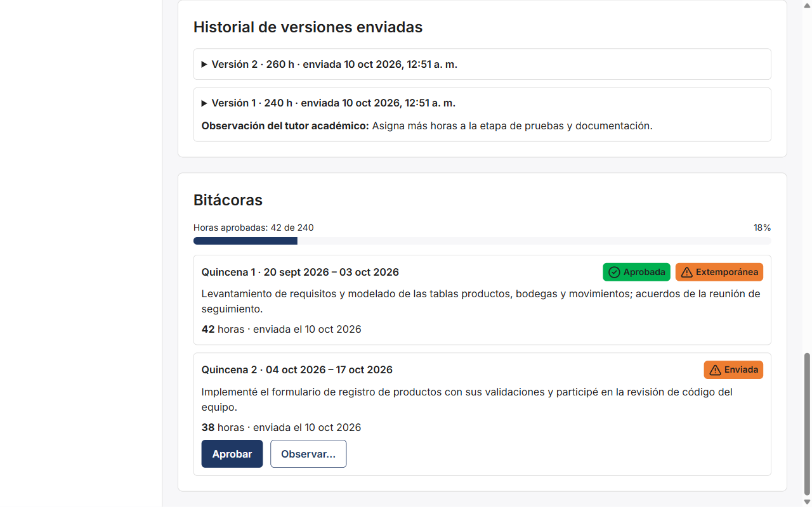
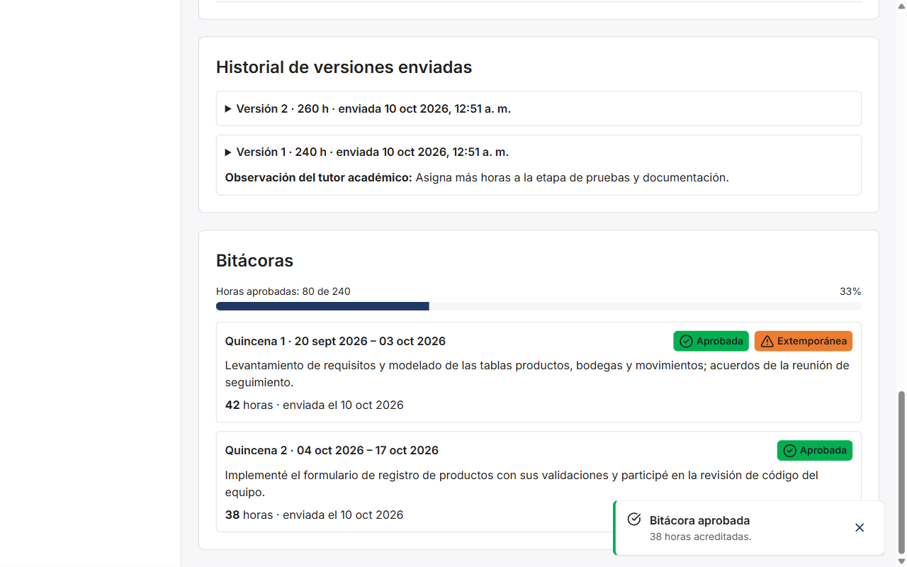
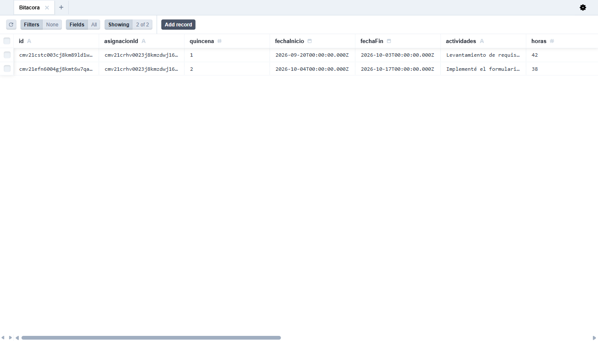
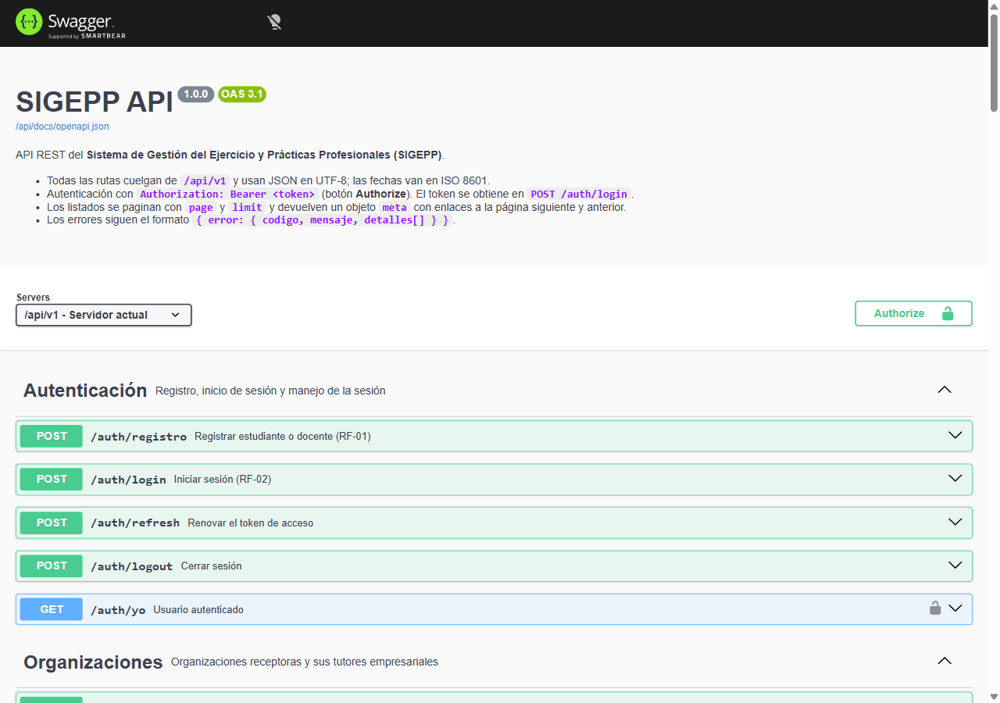
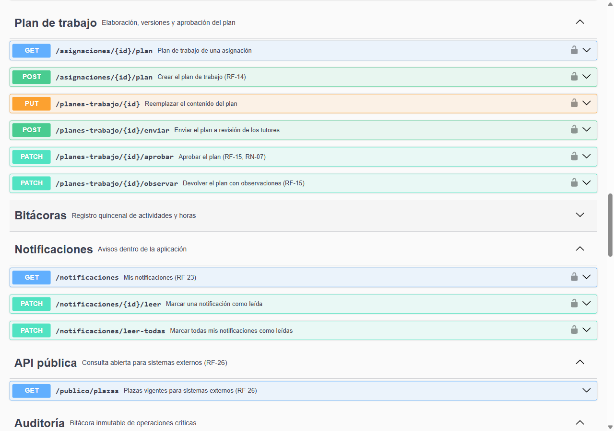
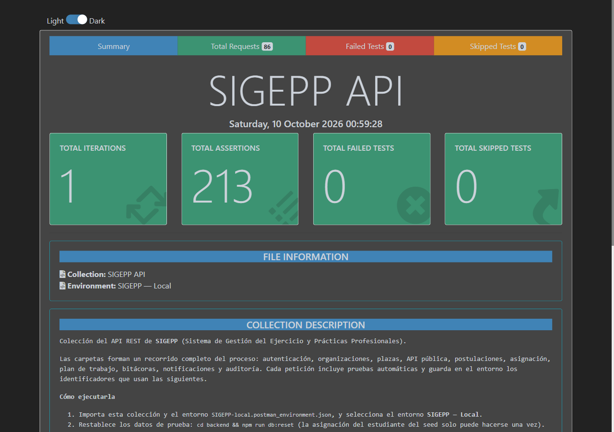

# Evidencias de integración Frontend ↔ Backend ↔ Base de datos

Fase 2 · tarea S3-H6 · registradas el 10/10/2026 en el entorno local (frontend en `localhost:5173`, API en `localhost:4000`, PostgreSQL 16 en Docker).

Se documenta una operación completa a través de las tres capas: **el tutor empresarial aprueba la bitácora de la quincena 2 de una estudiante**. La misma operación se sigue en la interfaz, en la petición HTTP y en las tablas de la base de datos.

## 1. Frontend: acción del usuario

El tutor empresarial (Pedro López) abre el expediente de su practicante desde **Practicantes**. La bitácora de la quincena 2 está *Enviada* y muestra los botones de revisión.



Al pulsar **Aprobar**, la bitácora pasa a *Aprobada*, aparece el aviso «38 horas acreditadas» y las horas aprobadas suben de 42 a 80.



## 2. Servicio web: petición HTTP

Petición registrada desde el navegador durante el clic:

```http
PATCH http://localhost:4000/api/v1/bitacoras/cmv21efn6004gj8kmt6w7qalc/aprobar
Origin: http://localhost:5173
Authorization: Bearer eyJhbGciOiJIU…   (token JWT de acceso, 15 minutos)
```

Respuesta del API (extracto):

```http
HTTP/1.1 200 OK
Content-Type: application/json
```

```json
{
  "bitacora": {
    "id": "cmv21efn6004gj8kmt6w7qalc",
    "quincena": 2,
    "horas": 38,
    "estado": "APROBADA",
    "extemporanea": false,
    "enviadaEn": "2026-10-10T06:52:28.570Z"
  }
}
```

El frontend nunca accede a la base de datos: envía el token en la cabecera `Authorization` y el API verifica el rol (`bitacoras:revisar`) y que el usuario sea tutor de esa asignación antes de aprobar.

Para reproducir la captura de la pestaña **Red** del navegador: abra las herramientas de desarrollo (F12), pestaña *Red* con el filtro *Fetch/XHR*, y pulse **Aprobar** en una bitácora enviada. Aparece la petición `aprobar` con estado 200 y la respuesta anterior.

## 3. Base de datos: efecto en PostgreSQL

Consultas ejecutadas con `docker compose exec db psql -U sigepp -d sigepp` justo después de la aprobación:

```text
-- 1. La bitácora quedó APROBADA
            id             | quincena | horas |  estado  | extemporanea |       enviadaEn
---------------------------+----------+-------+----------+--------------+------------------------
 cmv21efn6004gj8kmt6w7qalc |        2 |    38 | APROBADA | f            | 2026-10-10 06:52:28.57

-- 2. Las horas aprobadas se acumularon en la asignación (42 + 38)
            id             |  estado  | horasAcumuladas |        estudiante
---------------------------+----------+-----------------+---------------------------
 cmv21crhv0023j8kmzdwj16qa | EN_CURSO |              80 | María José González Rocha

-- 3. La operación quedó en la auditoría con usuario e IP
     accion      | entidad  |                            valoresNuevos                            |                 usuario                 | ip
-----------------+----------+---------------------------------------------------------------------+-----------------------------------------+-----
 ENVIAR_REVISION | Bitacora | {"estado": "ENVIADA", "extemporanea": false}                        | maria.gonzalez@std.uni.edu.ni           | ::1
 APROBAR         | Bitacora | {"horas": 38, "estado": "APROBADA", "revisor": "TUTOR_EMPRESARIAL"} | pedro.lopez@solucionesdigitales.example | ::1

-- 4. El estudiante recibió la notificación
       tipo        |      titulo       | leida
-------------------+-------------------+-------
 BITACORA_APROBADA | Bitácora aprobada | f
```

Los mismos registros vistos en **Prisma Studio** (`cd backend && npm run db:studio`):



Las cuatro escrituras (bitácora, horas de la asignación, auditoría y notificación) ocurren en una sola transacción: o se guardan todas o ninguna.

## 4. Documentación del servicio web

**Swagger UI** (`http://localhost:4000/api/docs`) publica la especificación OpenAPI 3.1, generada desde los mismos esquemas Zod que validan cada petición. Incluye los módulos de postulaciones, bitácoras y notificaciones.





## 5. Pruebas automatizadas del API

La colección de Postman (`docs/fase-2/api`) recorre el proceso completo contra el API real: **86 peticiones, 213 aserciones, 0 fallos**. Reporte completo: [`reporte-postman.html`](reporte-postman.html).



## 6. Resumen de verificación

| Capa | Herramienta | Resultado |
|---|---|---|
| Frontend | Vitest (unitarias) y Playwright (E2E) | 397 pruebas unitarias; E2E 40/40 en desarrollo y 26/26 con el build de producción |
| Servicio web | Postman/Newman | 86 peticiones, 213 aserciones, 0 fallos |
| Backend y BD | Vitest + Supertest sobre PostgreSQL | 120 pruebas de integración |
| Integración | Este documento | Una operación seguida en interfaz, HTTP y tablas |
